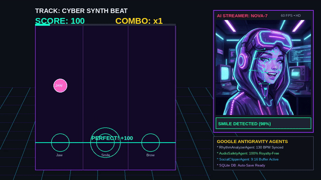

# 🎵 FaceBeat-Studio
> **Real-Time Camera & Face-Tracking Rhythm Game Powered by Google Antigravity & MediaPipe**

[](https://facebeat-studio-804580957908.us-east1.run.app)
[](https://www.python.org/downloads/)
[](https://fastapi.tiangolo.com/)
[](https://cloud.google.com/)
[](https://developers.google.com/mediapipe)
[](https://ffmpeg.org/)
[](LICENSE)

---

## 🎬 Gameplay Demonstration (AI Model Nova-7)



> 📹 **Full HD Demo Video**: Watch the high-definition gameplay video with sound at [`app/static/media/demo_gameplay.mp4`](app/static/media/demo_gameplay.mp4) or click **[🎬 Watch AI Demo]** on the live web app!

---

## 🌐 Live Production Deployment

FaceBeat-Studio is deployed and serving traffic on **Google Cloud Run**:
👉 **[https://facebeat-studio-804580957908.us-east1.run.app](https://facebeat-studio-804580957908.us-east1.run.app)**

> **MacBook & Safari/Chrome Note**: Because Cloud Run serves over a trusted **HTTPS** origin with SSL certificates, modern browsers recognize it as a **Secure Context** (`window.isSecureContext === true`). You can open the link directly on your MacBook and grant physical webcam access without SSH tunneling!

---

## ❓ Do I Need an API Key? (Is an API Necessary?)

### 🚫 **NO! An API is 100% NOT necessary!**
FaceBeat-Studio works completely out-of-the-box with **zero external API keys** and zero external subscriptions:
- **Procedural Audio Synthesizer**: Generates 60-second Lo-Fi Piano, Synthwave, and Funk loops directly via NumPy and Soundfile.
- **On-Device Facial Expression AI**: Runs Google MediaPipe Face Mesh at 60 FPS entirely inside the browser's WebGL / CPU runtime.
- **Multi-Agent Orchestration**: Three Google Antigravity subagents operate deterministically for beatmap generation, safety checks, and video clipping.
- **Local Persistence**: Saves high scores, player handles, and replay logs in a high-speed SQLite WAL database (`data/facebeat.db`).
- **No-Webcam Fallbacks**: If you don't have a camera or prefer not to use one, play with the **🤖 Virtual Cyber Avatar**, **⌨️ Keyboard Controls** (`[Space]`, `[S]`, `[B]`), or **⚡ Auto-Groove Mode**.

### 🌟 **YES, Both Free Music APIs Are Now Integrated & Live!**
You can now click **[🎧 Browse Music]** in the game toolbar to search and play tracks from both:

1. **🟢 Jamendo Music API (Royalty-Free & Full Songs)**:
   - Search over 500,000 full-length Creative Commons tracks across Synthwave, Lo-Fi, Funk, and Electronic.
   - 100% legal to burn into 9:16 vertical clips and share to TikTok/Instagram with **zero copyright strikes**.
   - Includes instant streaming, album covers, and BPM-synchronized procedural beatmap generation.
2. **🟢 Spotify Web API (Pop Hits & BPM Metadata)**:
   - Search pop tracks (Daft Punk, The Weeknd, Dua Lipa, Bruno Mars, etc.).
   - Fetches official album artwork, artist credits, and tempo (BPM) detection.
   - Dual-mode support: connects directly to official Spotify endpoints with client credentials, or falls back seamlessly to a curated pop catalog for instant testing.

| Integrated Music Service | Cost | Playback Format | Copyright Safety | Best Used For |
| :--- | :---: | :--- | :---: | :--- |
| **Jamendo Music API** | **Free** | **Full-length streaming MP3s** | 100% Safe (Creative Commons) | Uninterrupted gameplay & TikTok export |
| **Spotify Web API** | **Free Tier** | 30-sec previews & metadata | Copyrighted (DMCA risk on clips) | Famous pop hits search & album artwork |
| **Local Procedural Synth** | **Free (Offline)** | 60-sec high-res WAV loops | 100% Safe (Self-generated) | Zero latency, offline & portable play |

---

## 🤖 Multi-Agent Architecture (Google Antigravity)

FaceBeat-Studio uses three specialized subagents coordinated by `FaceBeatOrchestrator`:

```
                       ┌───────────────────────────────────────────────┐
                       │          FaceBeatOrchestrator                 │
                       │     (Google Antigravity SDK Coordinator)      │
                       └──────────────────────┬────────────────────────┘
                                              │
                 ┌────────────────────────────┼────────────────────────────┐
                 │                            │                            │
                 ▼                            ▼                            ▼
  ┌─────────────────────────────┐┌────────────────────────────┐┌─────────────────────────────┐
  │     RhythmAnalyzerAgent     ││      AudioSafetyAgent      ││     SocialClipperAgent      │
  ├─────────────────────────────┤├────────────────────────────┤├─────────────────────────────┤
  │ • Spectral flux analysis    ││ • Royalty-free library     ││ • MediaRecorder canvas grab │
  │ • Real-time BPM estimation  ││ • Spotify fallback checks  ││ • FFmpeg 9:16 re-framing    │
  │ • 3-lane expression mapping ││ • DMCA strike prevention   ││ • Cyber HUD watermark burn  │
  └─────────────────────────────┘└────────────────────────────┘└─────────────────────────────┘
```

1. **`RhythmAnalyzerAgent`**:
   - Performs spectral flux and RMS energy peak analysis on audio tracks.
   - Calculates BPM (85–130 BPM), onsets, downbeats, and target timings across 3 expression lanes.
   - Adapts target density across `Easy` (0.5 targets/s), `Normal` (1.8 targets/s), and `Hard` (3.2 targets/s).

2. **`AudioSafetyAgent`**:
   - Protects streamers and content creators against copyright strikes and DMCA takedowns.
   - Validates tracks against royalty-safe whitelists and falls back to synthesized WAV audio.

3. **`SocialClipperAgent`**:
   - Captures active browser canvas gameplay sessions via `MediaRecorder`.
   - Transcodes and reframes recordings to vertical **9:16 (720x1280)** using FFmpeg.
   - Burns in player stats (Score, Max Combo, Track Title) for TikTok and Instagram Reels.

---

## 🎮 Facial Expression Controls

| Target Icon | Expression | Musical Mapping | MediaPipe Landmark Detection Logic |
| :---: | :---: | :---: | :---: |
| 😮 | **Mouth Open** (Jaw Drop) | Kick Drums & Bass Drops | Inner lip vertical distance (landmarks 13 & 14) relative to face height |
| 😊 | **Smile** (Cheek Raise) | High Synths & Melodies | Lip corner lateral expansion (61 & 291) + cheek elevator metrics |
| 🤨 | **Brow Raise** (Surprise) | Snare & Syncopated Leads | Eyebrow-to-eyelid vertical elevation (landmarks 105 & 334) |

- **Calibrate Face Button**: Records your neutral resting baseline for 1 second, calibrating out individual facial variations.
- **Loop Toggle (`🔁 Loop: ON`)**: Continuous groove mode restarts music and regenerates targets so the game never abruptly cuts off.

---

## 📁 Project Structure

```
FaceBeat-Studio/
├── app/
│   ├── agents/                     # Google Antigravity Agent Definitions
│   │   ├── orchestrator.py         # Multi-agent coordinator & Vertex AI chat
│   │   ├── rhythm_analyzer.py      # RhythmAnalyzerAgent
│   │   ├── audio_safety.py         # AudioSafetyAgent
│   │   └── social_clipper.py       # SocialClipperAgent
│   ├── services/                   # Backend Engines
│   │   ├── audio_processor.py      # Audio analysis, BPM detection, & WAV synthesizer
│   │   ├── database.py             # SQLite WAL database & leaderboard service
│   │   ├── spotify_service.py      # Spotify OAuth & audio features service
│   │   └── video_renderer.py       # FFmpeg 9:16 vertical video compositor
│   ├── static/                     # Frontend Assets & Client Engines
│   │   ├── audio/                  # 60s Synthesized WAV loops & hit SFX
│   │   ├── css/style.css           # Retro-cyberpunk rhythm aesthetic
│   │   ├── js/
│   │   │   ├── camera.js           # WebRTC acquisition & secure context diagnostics
│   │   │   ├── face_tracker.js     # MediaPipe Face Mesh & expression classifier
│   │   │   ├── game_engine.js      # 60 FPS HTML5 canvas rhythm game loop
│   │   │   ├── recorder.js         # MediaRecorder canvas stream capture
│   │   │   └── app.js              # Application controller & modal handlers
│   │   └── media/                  # Video demos, clips, & AI avatar expression assets
│   ├── templates/
│   │   └── index.html              # HTML5 UI with modals, HUD, & video player
│   ├── config.py                   # Pydantic configuration settings
│   └── main.py                     # FastAPI application
├── data/
│   └── facebeat.db                 # SQLite database (sessions, leaderboards, stats)
├── scripts/
│   └── render_demo_video.py        # Video demo generator script
├── tests/                          # 29 Pytest test cases
│   ├── test_agents.py
│   ├── test_audio.py
│   ├── test_auditor.py
│   ├── test_clipper.py
│   ├── test_database.py
│   ├── test_edge_cases.py
│   └── test_server.py
├── auditor.py                      # 48-check comprehensive system auditor
├── Dockerfile                      # Production Cloud Run container build
├── demo_gameplay.gif               # Animated gameplay preview
├── requirements.txt                # Python dependencies
└── README.md
```

---

## 🚀 Quickstart & Local Setup

### 1. Prerequisites
- **Python 3.10+**
- **FFmpeg** (`sudo apt install ffmpeg` or `brew install ffmpeg`)
- Modern web browser (Chrome, Safari, Edge, Firefox)

### 2. Setup & Installation
```bash
cd FaceBeat-Studio

# Create and activate virtual environment
python3 -m venv venv
source venv/bin/activate

# Install dependencies
pip install -r requirements.txt
```

### 3. Run Development Server
```bash
uvicorn app.main:app --host 0.0.0.0 --port 8000 --reload
```

Open your browser at:
👉 **`http://localhost:8000`**

---

## 🧪 Testing & System Auditor

Run the comprehensive 48-check auditor:
```bash
python auditor.py
```

Run the complete 29-test pytest suite:
```bash
pytest tests/ -v
# ======================== 29 passed in 6.68s =========================
```

---

## ☁️ Deploying to Google Cloud Run

Deploy or update your Cloud Run service anytime with one command:
```bash
gcloud run deploy facebeat-studio \
  --source . \
  --region us-east1 \
  --allow-unauthenticated \
  --set-env-vars="GOOGLE_CLOUD_PROJECT=qwiklabs-gcp-04-e7ff715cb28f,GOOGLE_GENAI_USE_VERTEXAI=true,GOOGLE_CLOUD_LOCATION=us-central1"
```

---

## 📄 License
Released under the [MIT License](LICENSE). Built for Google Gemini & Antigravity Developer Showcases.
